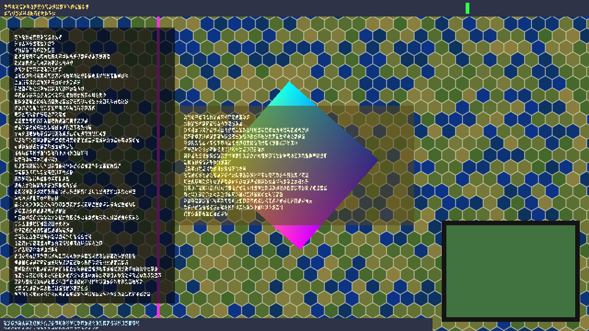

# Gate 3 compositor prototype

A 64-bit process renders the "world" into a shared D3D11 texture; a DLL
loaded into the 32-bit D3D11 game process draws that texture as a fullscreen
triangle under the game's 2D UI. This folder holds the three pieces, the test
harness that stands in for `CivilizationV_DX11.exe`, the measurements, and the
checklist for the first live-game run.

Nothing here has touched the real game: every number below comes from
`test_host.exe`.

**Result on the test host (RTX 4080, Windows 11 26100):** the composite appears exactly between the clear and the UI on blit and flip
swap chains, with MSAA and sRGB back buffers, and through a deferred-context
command list; it costs ~5 us of CPU per frame plus ~0.13-0.3 ms when a new
server frame is taken (`AcquireSync`, 60 times a second) and 14 us + 70 us of
GPU at 2560x1440; frame-time A/B over 60 s per mode shows no difference
between no DLL, off, passthrough and composite beyond run-to-run noise;
latency server-frame -> client-Present is 3-4 ms mean / 6-8 ms p99 with a
60 Hz server (0.3 ms with a free-running one); minimise, resize,
ResizeBuffers and a killed + relaunched server are all handled; a 10-minute
soak with 29 resizes shows no growth in private bytes, handles or video
memory. Two findings matter for the live run: the D3D11 runtime restores the
immediate context's ClearRenderTargetView vtable slot inside every Present and
ResizeBuffers (the DLL re-asserts it), and a clear recorded on a deferred
context is invisible to clear-based insertion (hence `insert=exec`).
Exclusive fullscreen was not exercised (it would disturb the game running on
the main monitor).

## Contents

| Path | What |
|---|---|
| `src/shell_server.cpp` | `shell_server.exe` (x64): renders the scene, publishes it in a shared NT-handle + keyed-mutex texture and a shared-memory header |
| `src/shell_composite.cpp` | `shell_composite.dll` (x86): vtable hooks, insertion logic, state save/restore, stats |
| `src/test_host.cpp` | `test_host.exe` (x86): the game stand-in |
| `src/shell_shared.h` | layout of the shared-memory section (checked for x86/x64 equality with static_asserts) |
| `src/shaders.hlsl` | all shaders, compiled offline by fxc (shader model 4.0) |
| `src/vtable_index.c` | vtable slot numbers taken from the SDK's C declarations (no hard-coded slots) |
| `shell_composite.ini` | DLL config (copied next to the DLL by the build) |
| `build.cmd` | builds everything into `bin\` |
| `tools/run_pair.ps1` | start server + host, take screenshots, collect logs in `runs\<name>\` |
| `tools/ab.ps1` | interleaved frame-time A/B over the five modes |
| `tools/soak.ps1` | long run with ResizeBuffers churn, samples private bytes of both processes |
| `tools/stats_summary.ps1`, `tools/ab_table.ps1` | aggregate the DLL's per-second stats lines / the A/B CSVs into the tables below |
| `tools/shot.ps1` | PrintWindow(PW_RENDERFULLCONTENT) capture of a test_host window (refuses CivilizationV*) |
| `results/` | the CSVs behind the tables below |
| `shots/` | screenshots |

## Design

```
 shell_server.exe (x64)                          test_host.exe / CivilizationV_DX11.exe (x86)
 ----------------------                          --------------------------------------------
 own D3D11 device (adapter by LUID               game device + immediate context + swap chain
 or the one with most VRAM)                         |
   render scene -> private RT                       | Present / ResizeBuffers   (IDXGISwapChain vtable, dxgi.dll)
   AcquireSync(0)  [or (1): overwrite]              | Clear / OMSetRenderTargets / ExecuteCommandList
   CopyResource -> shared texture  ======NT handle, named===> (per-object ID3D11DeviceContext vtable)
   write frame# + QPC into section                  v
   ReleaseSync(1)                                shell_composite.dll at the insertion point:
                                                   AcquireSync(1, timeout) -> read frame# + QPC
 Local\VPShellSection (4 KB):                      CopyResource -> local texture, ReleaseSync(0)
   texture name/size/generation (seqlock)         save state -> fullscreen triangle -> restore state
   frame counter + frame QPC (under the mutex)
   heartbeat QPC, resize requests (client->server)
```

### Server (`shell_server.exe`)

* Picks the adapter by `--luid HEX` or the non-software adapter with the most
  dedicated VRAM, and logs every adapter with its LUID. The client writes its
  own adapter LUID into the section and the server logs a MISMATCH warning if
  they differ (the shared texture cannot be opened across adapters).
* Renders a hex grid + spinning quad + a magenta bar that moves one pixel per
  frame, plus a 32-cell barcode of the frame counter in the top-left corner,
  into a private render target, then publishes it into the shared
  `B8G8R8A8_UNORM` texture created with
  `D3D11_RESOURCE_MISC_SHARED_NTHANDLE | D3D11_RESOURCE_MISC_SHARED_KEYEDMUTEX`
  and exported with `IDXGIResource1::CreateSharedHandle` as
  `Local\VPShellWorld_<pid>_<generation>`.
* Keyed mutex: `AcquireSync(0,0)`; if that fails, `AcquireSync(1,0)` (the
  client did not take the previous frame: it is overwritten and counted); if
  both fail for 50 ms the frame is skipped. Copy, write frame counter + QPC into
  the section, `ReleaseSync(1)`. With `--gpu-sync 1` (default) the server waits
  for the GPU to finish the copy before releasing, so the frame QPC is the
  GPU-complete time and the client never waits on the server's GPU work; the
  mutex is held for one copy, not a whole render. A server never blocks on a client that stopped presenting (minimised
  game, hung game), and a client never waits for the server (timeout 0).
* Rate: `--rate 60` (default, high-resolution waitable timer + spin), `--rate 0`
  = as fast as possible; GPU work in flight is capped at 2 frames with event
  queries (there is no swap chain to throttle it).
* Resize: the client writes the wanted size and bumps `reqSeq`; the server
  recreates both textures under a new generation number and name and publishes
  the new texture block under a seqlock. A restarted server starts at the size
  the client asked for last, so a restart costs no extra recreation.
* Logs per second (rendered/published/overwritten/skipped, max acquire wait)
  and every 10 s private bytes, working set and process video memory.

### Composite DLL (`shell_composite.dll`)

**Loading.** `DllMain` does nothing heavy: it pins the module (hooks point into
it), opens the log and starts a control thread. The control thread reads the
config and, unless `mode=off`, creates a dummy device + a blit-model and a
flip-model swap chain on two hidden windows, reads their vtable pointers,
destroys them, and patches `Present` (slot 8), `ResizeBuffers` (13) and
`Present1` (22) of the swap-chain vtable in `dxgi.dll` (same vtable for both
swap effects on this machine). Nothing waits for the host: loading after the
host created its device is the normal path, and loading before it works too
(both tested).

**The immediate context is hooked from the real one, not from the dummy.**
On Windows 11 the `ID3D11DeviceContext` vtable is a per-object table that
lives in heap memory right behind the context object (`ctx 030C00E0`, `vtbl
030C00E4` in the logs), so the dummy device's context vtable is useless. At the
first `Present` of the target swap chain the hook calls
`GetDevice -> GetImmediateContext` and patches that context's table:
`ClearRenderTargetView` (50), `OMSetRenderTargets` (33),
`ExecuteCommandList` (58).

**The runtime rewrites the ClearRenderTargetView slot inside every Present.**
Measured: right after the first patch, the next frame's clear was not seen;
`slot_rewrites` in the stats equals the frame count in every run. The
DLL re-asserts its context slots right after each original `Present` and
`ResizeBuffers` returns (one compare per slot; the table is in writable heap
memory so no VirtualProtect is needed). `OMSetRenderTargets` and `ExecuteCommandList` were
never rewritten. Each hook looks up its original by `(vtable, slot)`, so several
patched vtables never share one "original" pointer, and if somebody else
re-points a slot the hook chains to the new target.

**Target swap chain.** The first swap chain that presents is adopted (logged
with size, format, buffer count, swap effect, sample count, window and title).
Other swap chains are logged once and ignored; if the target stays silent for
2 s, the next presenting chain becomes the target.

**Insertion points** (`insert=` in the ini, `nth=` for N):

| insert | fires | draws into |
|---|---|---|
| `clear` (default) | after the first `ClearRenderTargetView` of the back buffer in the frame | that RTV |
| `nthclear` | after the N-th `ClearRenderTargetView` of any RTV in the frame | that RTV (viewport = its size) |
| `omset` | after the N-th `OMSetRenderTargets` that binds the back buffer at slot 0 | that RTV |
| `exec` | after the N-th `ExecuteCommandList` on the immediate context | own RTV on buffer 0 |
| `present` | just before `Present` (on top of everything; debug) | own RTV on buffer 0 |

The back buffer is recognised by comparing the RTV's resource with the raw
pointer of swap-chain buffer 0 (no reference is kept, so `ResizeBuffers` is
never blocked). Calls on other contexts (deferred contexts) are ignored by the
clear/omset hooks; their work reaches the immediate context through
`ExecuteCommandList`, hence the `exec` mode.

**At the insertion point:** open the texture by name if `(server pid,
generation)` changed (`ID3D11Device1::OpenSharedResourceByName`), check the
frame counter in the section first (skips the kernel call when nothing new was
published), `AcquireSync(1, timeout_ms)` (default 0), read frame counter + QPC
(consistent with the pixels because the server writes them while holding the
mutex), `CopyResource` into a local `B8G8R8A8_TYPELESS` texture,
`ReleaseSync(0)`, draw. On timeout the previous copy is drawn; on
`WAIT_ABANDONED` (server died holding the mutex) or an error the texture is
closed and re-opened when the server publishes again.

**State saved and restored around the draw:** IA input layout + topology (no
vertex/index buffer is bound: the triangle comes from `SV_VertexID`); VS, PS,
GS, HS, DS with their class instances (GS/HS/DS are nulled during the draw);
PS SRV slot 0 and sampler slot 0; RS state, all viewports, all scissor rects;
OM blend state + blend factor + sample mask, depth-stencil state + stencil ref,
all 8 RTVs + DSV; predication. The draw binds only the target RTV (no DSV),
depth/stencil off, cull none, opaque blend (or straight alpha with
`blend=alpha`).

**Formats.** If the target RTV is an `_SRGB` view, the local copy is sampled
through a `B8G8R8A8_UNORM_SRGB` view so decode + encode cancel out (verified:
same pixel values as the UNORM case). MSAA targets are drawn into directly
(all samples get the same value). The back-buffer dump resolves MSAA first.

**Robustness.** Every hook body runs under SEH; an exception or an unexpected
D3D failure sets `DISABLED` and the hooks keep passing calls through. Hooks
check `ctx == the target's immediate context` and a thread-local re-entrancy
flag (the DLL's own `OMSetRenderTargets` calls go through its own hook).
`ResizeBuffers` on the target releases every D3D object of the DLL (including
the shared and local textures and its own back-buffer RTV) before calling the
original, then re-reads buffer 0 and asks the server for the new size.

**Config and live switching.** `shell_composite.ini` next to the DLL, every key
overridable by an environment variable `VPSHELL_<KEY>`. The control thread
re-reads the ini when its timestamp changes, so `mode` / `insert` / `nth` can
be switched while the host runs; `mode=off` unpatches every slot, switching
back re-patches. Trigger files next to the DLL: `shell_composite.shot` dumps
the next presented back buffer to a BMP (`shot_dir=`), `shell_composite.trace`
logs every clear / OMSetRenderTargets / ExecuteCommandList of the next frames
(`[trace] frames=N` inside the file, default 2). The first `trace_frames`
frames after adopting a swap chain and after every `ResizeBuffers` are always
traced.

**Log** (`shell_composite.log` next to the DLL, or `VPSHELL_LOG`): one `stats`
line per second with frames, Present-to-Present frame time (mean / p99 /
max), CPU cost inside the insertion (`comp_*`), `AcquireSync` CPU time
(`acq_*`), GPU time of the composite from timestamp queries split into frames
that only draw (`gpu_draw_*`) and frames that also copy a new server frame
(`gpu_copy_*`, with `gpu_syncwait_*` the part up to the `AcquireSync`), latency server-release to client-Present for new frames
(`lat_*`), mean age of what is displayed (`age_mean`), new / dropped server
frames (`srv_new`, `srv_drop` = gaps in the server's frame counter), frames
that showed the previous copy (`dup`), mutex timeouts, frames where the
insertion point never fired (`missed_ins`), context-slot rewrites, clears per
frame, server staleness and texture/back-buffer sizes.

### Test host (`test_host.exe`)

Window + D3D11 device + swap chain: `--swap blit` (`DXGI_SWAP_EFFECT_DISCARD`,
1 buffer, the likely 2010-era setup), `flip` (`FLIP_DISCARD`) or `flipseq`;
`--buffers`, `--format rgba|bgra|srgb`, `--msaa N`, `--vsync 0|1`. Each frame
clears to grey, then draws "UI": opaque top/bottom bars and minimap box, a 70 %
opaque left panel and a 55 % opaque centre dialog, each with alpha-tested
glyph noise. `--deferred` records the clear on a deferred context and runs it
through `ExecuteCommandList` (the Civ 5 pattern). `--load before|after|none`
(after = at frame 30, long after the device exists), `--bb WxH` fixes the
back-buffer size independently of the window, `--scenario robust` scripts
minimise / restore / window resize / ResizeBuffers 1920x1080 and 2560x1440 /
window back (/ fullscreen with `--allow-fullscreen`), `--churn N` calls
ResizeBuffers every N seconds (soak). F1 = ResizeBuffers to the next
resolution, F2 = fullscreen toggle, F3 = resize window. The window is shown
with `SW_SHOWNOACTIVATE` and opens on the left monitor so it never takes the
foreground. Logs 1 s frame stats, 10 s memory, and a summary (first 3 s
excluded) that `--summary` appends to a CSV.

## Build

```
experiments\shell-gates\compositor\build.cmd
```

From any shell; needs VS 2022 (MSVC v143, `VSDIR` overridable) and Windows SDK
10.0.26100.0 (`fxc`; `SDKVER` overridable). Output in `bin\`; static CRT
(`/MT`), so the DLL brings no runtime dependency into the game process.
`bin\`, `build\` and `runs\` are git-ignored.

## Run

```
bin\shell_server.exe [--size 1920x1080] [--rate 60|0] [--luid HEX] [--seconds N]
bin\test_host.exe    [--swap blit|flip] [--vsync 0|1] [--load after] [--bb 2560x1440] [--scenario robust] ...
```

Start order does not matter: the DLL opens `Local\VPShellSection` once per
second until it exists. `tools\run_pair.ps1 -Name x -HostArgs '...' -Env
@{VPSHELL_INSERT='omset'} -Seconds 10 -ShotAt 5` does one run with logs in
`runs\x\`; `tools\ab.ps1` and `tools\soak.ps1` reproduce the tables below.

## Results (test host)

Machine: RTX 4080 (LUID `E0D7`), Windows 11 26100, d3d11.dll 10.0.26100. The
host window sits on a 165 Hz monitor, so "vsync on" = 165 fps. The real game
was running on the same GPU during every measurement (another agent's probes),
which is the main source of run-to-run noise.

### (i) The composite sits above the clear and under the UI



`shots/10-blit-clear-t5.png`, blit model, `insert=clear`: the hex world fills
the frame where the host only cleared to grey; the opaque top/bottom bars and
minimap box cover it; the 70 % left panel and the 55 % centre dialog show it
through; the host's text noise is on top. The server's frame-counter barcode
(top-left) is hidden by the top bar, as it should be. With `insert=present`
(`shots/14-blit-present-t5.png`) the world covers the whole UI and the
barcode is visible: the debug mode works as intended.

Functional matrix (8 s runs, 165 Hz vsync, 1280x720, server 60 Hz; stats over
the last 3-5 s, `results/runs_summary.csv`):

| run | swap chain / host | insert | composite visible, UI on top | DLL CPU mean / p99 (ms) | latency mean / p99 (ms) | missed insertions |
|---|---|---|---|---|---|---|
| 10 | blit DISCARD, 1 buffer, RGBA8 | clear | yes | 0.17 / 0.73 | 3.1 / 7.2 | 0 |
| 11 | flip DISCARD, 2 buffers | clear | yes | 0.15 / 0.60 | 3.4 / 6.0 | 0 |
| 12 | blit | nthclear, N=1 | yes | 0.18 / 0.74 | 3.1 / 6.0 | 0 |
| 13 | blit | omset | yes | 0.28 / 1.13 | 5.3 / 9.2 | 0 |
| 14 | blit | present | yes, on top of the UI (by design) | 0.23 / 0.94 | 3.6 / 8.0 | 0 |
| 15 | blit, 4x MSAA back buffer | clear | yes | 0.24 / 0.90 | 3.4 / 6.6 | 0 |
| 16 | blit, R8G8B8A8_UNORM_SRGB | clear | yes, colours identical to run 10 (pixel check) | 0.17 / 0.63 | 4.6 / 10.7 | 0 |
| 17 | blit, DLL loaded **before** device creation | clear | yes | 0.15 / 0.75 | 3.5 / 6.9 | 0 |
| 18 | flip DISCARD, 3 buffers, BGRA8 | clear | yes | 0.14 / 0.55 | 3.5 / 6.2 | 0 |
| 19a | blit, clear on a **deferred context** + ExecuteCommandList | clear | **no** (never fires: `missed_ins` = every frame) | - | - | all |
| 19b | same | exec, N=1 | yes | 0.12 / 0.53 | 3.2 / 6.7 | 0 |

Screenshots for each are in `shots/` (`<run>-t5.png`). Run 19a is the
expected failure that motivates the `exec` mode and step 2 of the checklist.

### (ii) Frame time: no DLL / off / passthrough / composite

Host uncapped (`--vsync 0`), back buffer fixed at **2560x1440** (window
1280x720), blit model, server at 60 Hz rendering 2560x1440. Five modes
interleaved over 3 rounds of 20 s (60 s per mode; a fresh host process per
run; first 3 s of each run dropped). `tools/ab.ps1`, `results/ab_*.csv`.

| mode | frames | host frame time mean (ms) | spread of the 3 run means | host p99 (ms) | DLL CPU per frame mean / p99 (ms) | AcquireSync CPU per new frame (ms) | GPU, draw-only frame (ms) | GPU, copy + draw frame (ms) |
|---|---|---|---|---|---|---|---|---|
| no DLL | 556,148 | 0.0927 | 0.082 - 0.106 | 0.296 | - | - | - | - |
| off (DLL loaded, no hooks) | 549,789 | 0.0944 | 0.082 - 0.112 | 0.310 | - | - | - | - |
| passthrough (hooks, no draw) | 550,803 | 0.0927 | 0.089 - 0.097 | 0.291 | - | - | - | - |
| composite, insert=clear | 584,818 | 0.0873 | 0.084 - 0.091 | 0.289 | 0.0053 / 0.0116 | 0.126 | 0.0143 | 0.078 |
| composite, insert=present | 582,290 | 0.0877 | 0.085 - 0.092 | 0.290 | 0.0051 / 0.0103 | 0.130 | 0.0135 | 0.075 |

At ~11,000 frames/s the five modes are indistinguishable: the differences
between modes (< 0.01 ms) are smaller than the spread between runs of the same
mode (up to 0.03 ms), which comes from the GPU being shared with the running
game. The direct measurements are the useful numbers: per composited frame the
DLL spends ~5 us of CPU when there is no new server frame and ~0.13 ms more
(`AcquireSync`) when there is one (60 times a second); the GPU spends 14 us on
the 2560x1440 fullscreen draw and ~75 us on a frame that also copies the
14.7 MB shared texture.

At display rate the CPU costs are higher because the CPU sits in low clock
states between frames (runs 30 and 33, 165 Hz vsync, 2560x1440 back buffer):

| run | mode | frames | host frame time mean / p99 (ms) | DLL CPU per frame mean / p99 (ms) | AcquireSync mean / p99 (ms) |
|---|---|---|---|---|---|
| 33 (30 s) | passthrough | 4,441 | 6.08 / 7.98 | - | - |
| 30 (60 s) | composite, clear | 9,339 | 6.10 / 9.69 | 0.118 / 0.494 | 0.248 / 0.450 |

**GPU timestamps across the keyed mutex are not a cost measure at display
rate.** The DLL brackets the composite with timestamp queries and splits
frames that copy a new server frame into "up to the `AcquireSync`"
(`gpu_syncwait`) and "copy + draw" (`gpu_copy`):

| run | host | GPU draw-only frame (ms) | GPU sync part (ms) | GPU copy + draw (ms) | host frame time (ms) |
|---|---|---|---|---|---|
| 37 | uncapped | 0.014 | 0.044 | 0.070 (p99 0.15) | 0.084 |
| 36 | 165 Hz vsync | 0.26 | 0.009 | 5.1 (p99 7.7) | 6.10 |

At 165 Hz the copy span is 5 ms although the same copy takes 0.07 ms when the
GPU is kept busy, and the host's frame time and p99 do not move against
passthrough (6.10 / 9.7 vs 6.08 / 8.0 ms). `AcquireSync` makes the runtime
submit the command buffer and queue a wait on the shared sync object, so the
commands after it (copy, draw, and the rest of the host's frame) land in the
next submission; the span measures the GPU timeline until that submission
runs, mostly idle time at low load and low clocks, not work. Draw-only frames
grow from 14 us to 0.15-0.26 ms for the same reason (GPU clocks drop between
frames at 165 Hz with this tiny workload). Two consequences for the game: one
extra command-buffer split per new server frame (60/s), and the GPU numbers
that matter must come from a busy GPU or from GPUView/PIX, not from these
timestamps. To rule out that the client waits for the *server's* GPU work, the
server by default (`--gpu-sync 1`) waits for its copy to finish before
`ReleaseSync(1)`; with or without it the spans were the same (runs 34 / 35:
5.9 vs 6.2 ms), and `gpu_syncwait` is 9-44 us.

### (iii) Latency server frame -> client Present

`lat` = client `Present` call time minus the QPC the server wrote right before
`ReleaseSync(1)` of that frame (same machine, same QPC clock), for frames that
brought new content; `age` = the same for every displayed frame including
repeats.

| run | host | server | lat mean / p99 (ms) | age mean (ms) | server frames shown | dropped (overwritten before the host took them) | repeats |
|---|---|---|---|---|---|---|---|
| 30 | vsync 165 Hz, 2560x1440 | 60 Hz | 4.03 / 7.79 | 8.72 | 3,376 in 56 s (60.3/s) | 0 | 5,849 |
| 31 | vsync 165 Hz, 2560x1440 | as fast as possible (~4,000/s) | 0.27 / 0.80 | 0.89 | 3,867 | 128,371 | 379 |
| 32 | uncapped (~3,700 fps), 2560x1440 | as fast as possible | 0.33 / 0.63 | 0.43 | 53,518 | 31,324 | 42,247 |

With a 60 Hz server and a host that presents faster, the content is on average
half a server period old plus the time to the host's next insertion point, and
every server frame is shown exactly once (0 dropped). A free-running server
drives latency under 1 ms at the cost of rendering frames nobody sees.

### (iv) Robustness

| event | how | result |
|---|---|---|
| minimise / restore | `--scenario robust` (ShowWindow) | Present returns `DXGI_STATUS_OCCLUDED`, host drops to 33 fps, composite keeps running; normal after restore (`runs/20-robust`) |
| window resize | 1280x720 -> 1024x640 -> back | DLL releases everything before the original ResizeBuffers (0.6 ms, returned S_OK), asks the server for the new size, server recreates the texture (generation +1), new texture opened 0.25 s later; old one drawn stretched in between |
| ResizeBuffers to another resolution | 1920x1080 and 2560x1440 in a 1024x640 window | same path, S_OK, `shots/20-robust-t16.png`, `-t20.png` |
| fullscreen toggle | not run, see limitations | - |
| server killed (TerminateProcess) | `runs/21-server-restart` | 1 s later `server STALE`; the last copied frame keeps showing (`shots/21-server-killed.png`); no errors, host unaffected |
| server relaunched | new process, new pid | `server alive again`, texture `Local\VPShellWorld_<newpid>_1` opened by name within 0.3 s (`shots/21-server-restarted.png`); with the current build the new server starts at the client's last requested size |
| DLL loaded before / after the device | `--load before`, `--load after` (frame 30) | both work (runs 17, 10) |
| live mode switch | edit the ini while running | applied at the next Present; `off` unpatches, other modes re-patch |

### (v) 10-minute soak

`tools/soak.ps1`: server at 60 Hz, host at 165 Hz vsync, insert=clear, and
`ResizeBuffers` every 20 s cycling 1280x720 -> 1920x1080 -> 2560x1440
(29 resizes, 31 server texture generations), 600 s. Private bytes and handles
sampled every 30 s from outside (`results/soak_mem.csv`):

| process | private bytes at 30 s | at 120 s | range 120-600 s | at 600 s | handles 120 -> 600 s |
|---|---|---|---|---|---|
| test_host.exe (with the DLL) | 33.92 MB | 34.20 MB | 34.08 - 34.86 MB | 34.82 MB | 435 -> 441 (range 432-445) |
| shell_server.exe | 65.32 MB | 82.39 MB | 82.34 - 82.52 MB | 82.50 MB | 441 -> 435 (range 433-441) |

No growth trend: the host moves within a 0.8 MB band without a direction, the
server is flat after its first 2560x1440 texture pair (the step from 65 to
82 MB in the first minute). Process video memory at the same back-buffer size
is identical at minute 1 and minute 10 (host at 2560x1440: 56.47 MB both;
server at 2560x1440: 50.45 MB both). Over the 600 s: 98,074 frames, 35,383
server frames shown, 2 dropped, frame time 6.09 / p99 8.40 ms, DLL CPU
0.150 / p99 0.574 ms per frame, latency 3.9 / p99 7.1 ms, no DLL errors. The
soak exposed one bug, fixed and re-verified since: `ResizeBuffers` also
restores the ClearRenderTargetView slot, so the first frame after each resize
missed its insertion (29 `missed_ins`); the DLL now re-asserts its slots after
`ResizeBuffers` as well (`runs/23-robust-v2`: 0 missed).

## Screenshots

| file | shows |
|---|---|
| `shots/10-blit-clear-t5.png` | default: blit model, insert=clear, UI over the world |
| `shots/11-flip-clear-t5.png` | flip model |
| `shots/12-blit-nthclear1-t5.png`, `13-blit-omset-t5.png` | other insertion points |
| `shots/14-blit-present-t5.png` | insert=present: world over the UI, barcode visible |
| `shots/15-blit-msaa4-t5.png` | 4x MSAA back buffer |
| `shots/16-blit-srgb-t5.png` | sRGB back buffer: the world is unchanged, the host's own UI is washed out (the host writes linear colours into an sRGB target; the composite is not affected) |
| `shots/17-load-before-t5.png`, `18-flip-bgra-3buf-t5.png` | load order, BGRA flip with 3 buffers |
| `shots/19-deferred-execmode-t5.png` | host clears on a deferred context, insert=exec |
| `shots/20-robust-t4/t10/t14/t16/t20/t23.png` | before minimise, after restore, 1024x640 window, back buffer 1920x1080 and 2560x1440 in that window, back to 1280x720 |
| `shots/21-server-killed.png`, `21-server-restarted.png` | frozen last frame while the server is dead, live again after relaunch |

## Loading the DLL into the real game

The coordinator's hook in `CvGameCore_Expansion2.dll`: at `DllGetGameContext`
time (main menu), read `<My Games>\Sid Meier's Civilization 5\crashlogs\shell.helper`
(one line, absolute path) and `LoadLibraryW` it once. That fits this DLL:

* `DllMain` only pins the module, opens the log and starts the control thread;
  all hooking happens on that thread after the loader lock is released, and the
  context hooks are installed from inside the first `Present` on the game's
  render thread. Loading long after the device exists is the tested default
  (`--load after`); there is no time limit.
* `DllGetGameContext` is not called under the loader lock anyway, but nothing
  in the DLL depends on that.
* Dependencies: `d3d11.dll`, `user32.dll`, `kernel32.dll` only (static CRT;
  `dumpbin /dependents`). Never call `FreeLibrary` on it (it pins itself
  regardless: the hooks point into it).
* `shell_composite.ini` and `shell_composite.log` live next to the DLL, so put
  the DLL in a writable folder outside the Steam install (for example a
  `shell\` folder in the worktree, or next to the marker in `crashlogs\`).
* Log the `LoadLibraryW` result and `GetLastError()` in the game DLL; a NULL
  return with error 126 is a wrong path, 193 a 64-bit build.
* `shell_server.exe` is started separately (before or after the game; the DLL
  polls for the section once per second). It will be asked for a texture the
  size of the game's back buffer.
* Kill switches: delete the marker (next start), or set `mode=off` in the ini
  while the game runs (unpatches every slot within 0.5 s).
* Cost in the 32-bit address space: the dummy device + two 16x16 swap chains
  exist for a few milliseconds at load; afterwards the DLL holds about 0.5 MB of
  static data, a few D3D state objects, 24 queries and two textures the size
  of the back buffer (the opened shared one and the local copy, both GPU-only,
  no CPU mapping). Not yet measured inside the game.

## Checklist for the first live-game run

**0. Before starting.** Build. Copy `bin\shell_composite.dll` + `.ini` to the
chosen folder. Set `mode=passthrough`, `insert=clear`, `trace_frames=3`. Start
`bin\shell_server.exe --rate 60`. Write the marker. Do **not** run RenderDoc and
the helper in the same session: RenderDoc wraps the device, so the DLL would
patch RenderDoc's wrapper vtables and both captures become hard to read. Do a
RenderDoc capture alone first if time allows.

**1. Read the log top-down (main menu).**
* `loaded into pid ... CivilizationV_DX11.exe`, `swap-chain vtables: blit X,
  flip Y`, three `patch ... ok` lines.
* `adopted swap chain`: note width x height (2560x1440 expected), `fmt`
  (28 = R8G8B8A8_UNORM, 29 = its sRGB, 87 = B8G8R8A8_UNORM, 91 = its sRGB),
  `buffers`, `effect` (0 = DISCARD, 1 = SEQUENTIAL, 3 = FLIP_SEQUENTIAL,
  4 = FLIP_DISCARD), `samples` (> 1 = MSAA back buffer), `windowed`, window
  title. If instead `WARNING: hooks installed 10 s ago but no Present seen`
  appears, the game's swap chain does not use the dxgi.dll vtable the dummy
  found (another overlay wrapping it, or an older DXGI path): stop and look at
  which module the game's `Present` lives in.
* `another swap chain presents` lines: a second swap chain exists (second
  window, tablet UI). Check that the adopted one is the 2560x1440 main window.
* Three `patch ID3D11DeviceContext::...` lines with a vtable address right
  behind the context address.

**2. Read the frame trace** (the `trace:` lines of the first 3 frames; write an
empty `shell_composite.trace` next to the DLL to get more, e.g. in game rather
than at the menu). Questions, in this order:
1. Is the back buffer cleared on the immediate context (`clear #n ... <== BACK BUFFER`)?
   `missed_ins` in the passthrough stats answers it for every frame: 0 means
   the `clear` insertion point fires each frame.
2. How many `ExecuteCommandList`s per frame? Civ 5 is known for DX11
   multithreaded rendering: if most work arrives in command lists, clears on
   deferred contexts are invisible here and the insertion point is an
   `ExecuteCommandList` index (`insert=exec`, `nth=k`).
3. Does the world render into an offscreen target (an RTV of screen size,
   possibly MSAA, possibly a float format such as 10 = R16G16B16A16_FLOAT or
   26 = R11G11B10_FLOAT) that is later resolved or blitted into the back buffer?
   Then the first `OMSetRenderTargets` that binds the back buffer *after* that
   pass is where the UI starts: `insert=omset`, `nth=k`.
4. Which `OMSetRenderTargets` binding of the back buffer starts the UI pass?
   (`omsets N, of which bind the back buffer M` per frame.)

**3. First composite: `insert=present`.** Edit the ini (it is re-read live).
The hex world must cover everything, UI included. This proves, inside the game
process, the same adapter, `OpenSharedResourceByName`, the keyed mutex and the
state restore (the game must keep rendering normally underneath). Write an
empty `shell_composite.shot` to dump the back buffer to a BMP. Check the stats:
`lat_mean`, `gpu_copy_mean`, `comp_mean`, `missed_ins=0`, `srv_drop`, `dup`.

**4. Under the UI.** Switch to the insertion point the trace suggested:
`clear` if the back buffer is cleared at frame start on the immediate context
(that places the world *under* the game's own 3D world, so it only shows once
the EXE's world rendering is turned off, see `[DisableSystems]`), else
`omset` / `exec` with the `nth` from the trace, else `nthclear`. Confirm with a
`.shot` that the UI is on top and the world shows through translucent panels.

**5. What can go wrong, and how it shows.**

| Symptom | Likely cause | What to do |
|---|---|---|
| no `adopted swap chain` | game Present is not on the dummy's vtable | find the module; hook that vtable or the function |
| `missed_ins` = frames in `clear` mode, `clears_pf` 0 | back buffer cleared on a deferred context, or never cleared | use `exec` / `omset` |
| composite visible but covered by the world | inserted before the 3D pass | later `nth`, or `omset` after the world's resolve |
| world resolved into the back buffer with `ResolveSubresource` / `CopyResource`, no clear or bind in between | no hook on those calls yet | add an insertion after `ResolveSubresource` (slot 57) - not implemented |
| `samples` > 1 | MSAA back buffer | handled (drawn into all samples); `.shot` resolves |
| washed-out or too dark composite | sRGB mismatch | handled for `_SRGB` RTVs; check `viewfmt` in the trace |
| `OpenSharedResourceByName ... failed` with LUID mismatch | game on another adapter (hybrid laptop) | start the server with `--luid` = the LUID the DLL logs |
| `slot_rewrites` = 0 and clears missed | the runtime changed how it rewrites the table | the stats show it; re-assert point may need to move |
| `DISABLED` in the stats | an exception or failure inside the DLL | the log line before it says where; hooks keep passing through |
| UI flickers or vanishes after the composite | a piece of state not restored (UAVs, other PS slots, stream-out) | compare in RenderDoc the state before/after the inserted draw |
| game crash with the helper loaded | not expected: report the log tail | `mode=off` isolates hooks vs. drawing |
| `stale=1`, frozen world | server not running or hung | the last frame keeps showing (`hide_when_stale=1` hides it) |

**6. Record:** the full log, the trace lines, two `.shot` BMPs (present mode,
final mode), the stats over 60 s in each of `passthrough` and the final
composite mode (switch live via the ini), and Task Manager's GPU engine use of
both processes.

## Known limitations and open points

* **Exclusive fullscreen toggle not exercised.** The code path
  (`SetFullscreenState` -> `WM_SIZE` -> `ResizeBuffers`) uses the same
  release/re-acquire path that the window-resize and ResizeBuffers tests
  passed, and the host supports it (`--scenario robust --allow-fullscreen`,
  F2), but switching a window to exclusive fullscreen takes the foreground and
  could knock the game (running another agent's probes on the main monitor)
  out of its own fullscreen. Run it when the game is not running.
* Latency is CPU time: server `ReleaseSync` submit to client `Present` call.
  It excludes the GPU execution of both sides and scan-out.
* `AcquireSync` costs 0.1-0.6 ms of CPU per new server frame (a kernel
  transition), paid on the game's render thread 60 times a second; mutex polls
  without a new frame are skipped by checking the frame counter first. A shared
  `ID3D11Fence` (the runtime is the OS's, so available to the 2010 game on
  Windows 10+) or a ring of textures would be cheaper.
* Not hooked: `IDXGISwapChain3::ResizeBuffers1`, `ClearView`,
  `OMSetRenderTargetsAndUnorderedAccessViews` (a back-buffer bind through it is
  not seen by `omset`), `ResolveSubresource` / `CopyResource` as insertion
  points, deferred contexts themselves.
* The state restore does not cover UAVs bound through
  `OMSetRenderTargetsAndUnorderedAccessViews` (restoring the RTVs with
  `OMSetRenderTargets` may unbind them) or stream-out targets; only PS SRV and
  sampler slot 0 are touched, so other slots need no restore.
* Only the first presenting swap chain is composited.
* Untested: multi-adapter, the D3D debug layer, coexistence with the Steam
  overlay or RenderDoc, the real game.
